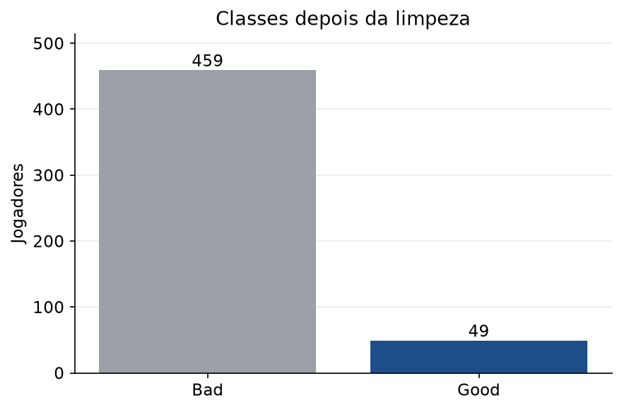
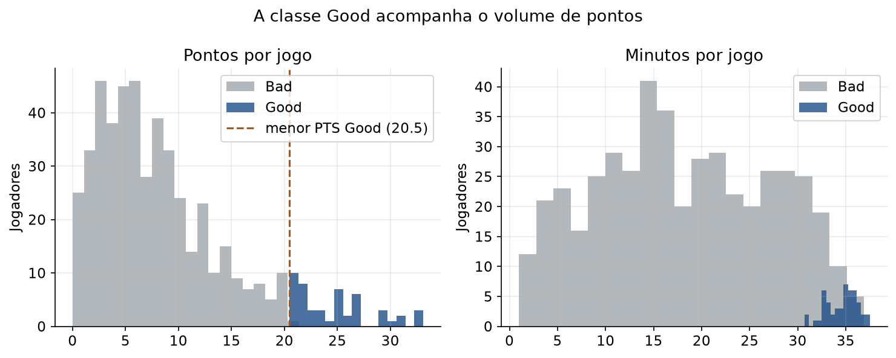
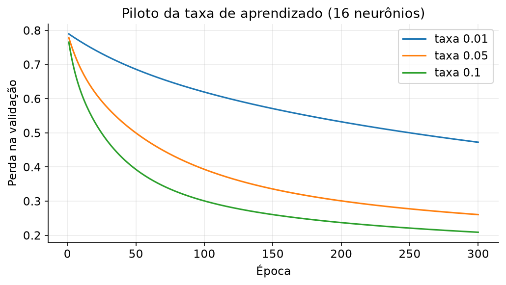
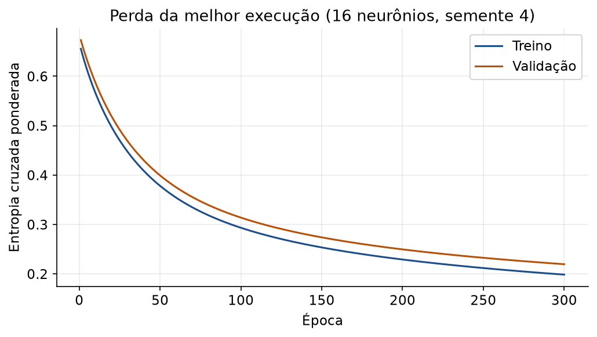
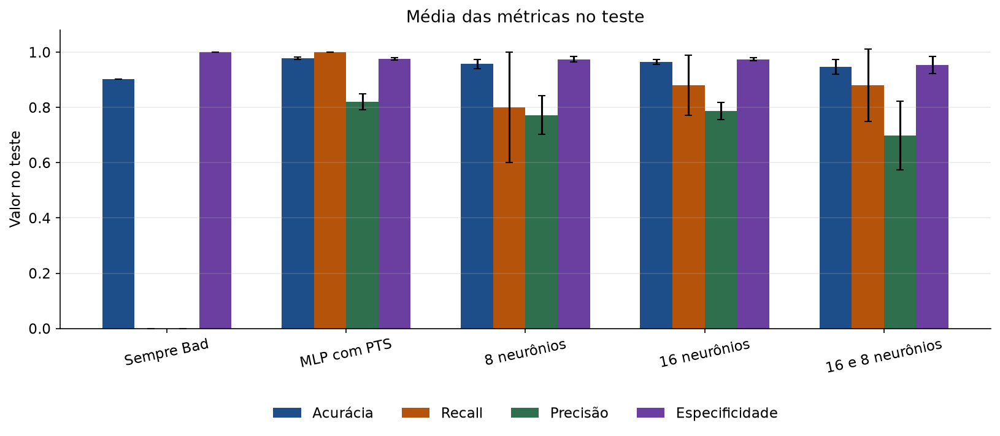
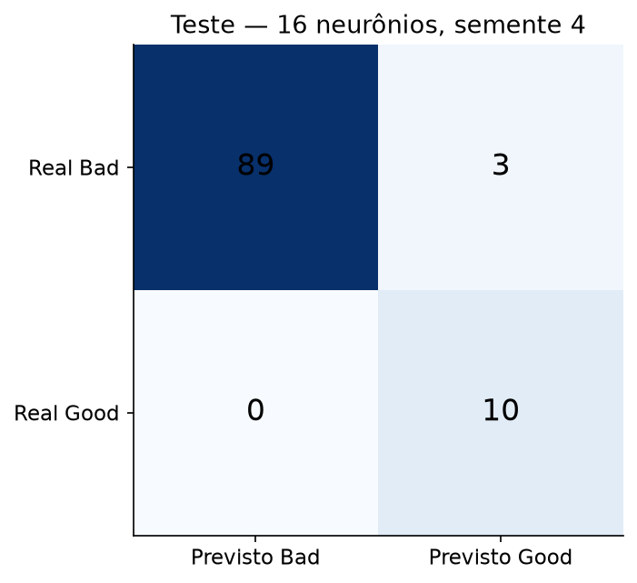
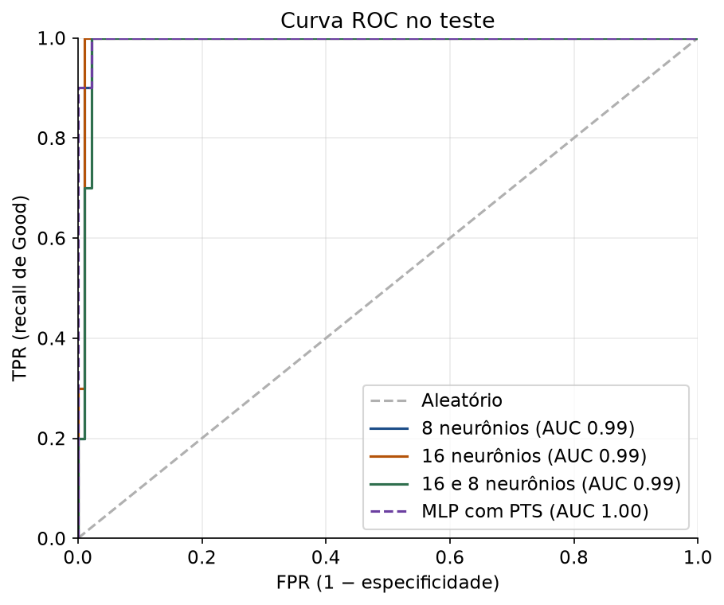
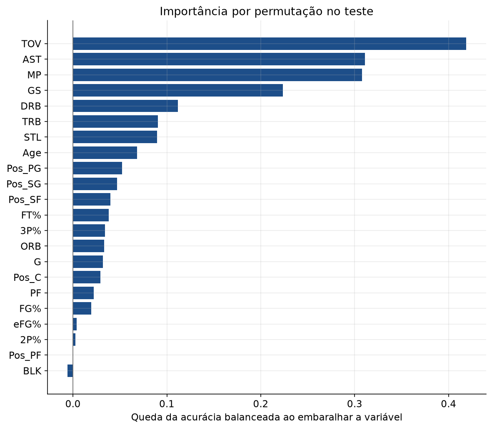

# Rede neural MLP para prever o desempenho de jogadores da NBA

Disciplina: FBX4054 — Inteligência Computacional

Alunos: preencher

Semestre: preencher

O objetivo deste trabalho é implementar um perceptron multicamada (MLP) do zero e usá-lo para classificar jogadores da NBA em `Good` ou `Bad`. A rede, a função de ativação, a retropropagação e as métricas foram escritas em Python, sem biblioteca de machine learning. Pandas organiza a tabela, o `StandardScaler` só padroniza as entradas, o `confusion_matrix` só monta a matriz, e o matplotlib desenha os gráficos.

A classe positiva é `Good`. O resultado central é duplo. A etiqueta acompanha o volume de pontos, então uma rede que recebe `PTS` quase separa as classes. A rede principal, de propósito, não recebe as variáveis de cesta. Ela ainda reconhece os jogadores `Good`, e o que pesa nessa decisão é o papel em quadra (turnovers, assistências, minutos e titularidade), não o aproveitamento dos arremessos.

## 1. Preparação dos dados

A tabela original tem 624 linhas e o formato de estatísticas por jogo de uma temporada. Há identificação (`Player`, `Pos`, `Age`, `Tm`), volume e aproveitamento de arremessos, rebotes, assistências, roubos, tocos, turnovers, faltas, pontos e a coluna `Performance`.

A limpeza ficou assim:

- 2 linhas inválidas saíram (jogador ou classe ausente). Restaram 622.
- A coluna `FG%.1` repete `FG%` com vírgula decimal e foi removida.
- 57 jogadores aparecem mais de uma vez, em geral por troca de time, com uma linha `TOT` e linhas parciais. Foram removidas 114 linhas repetidas. Quando existe `TOT`, fica só ela; caso contrário, fica a linha do time com mais jogos. O conjunto final tem uma linha por jogador, para a mesma pessoa não cair ao mesmo tempo em treino e teste.
- 4 posições híbridas (`PF-SF` e similares) foram reduzidas à primeira sigla. Nenhuma linha ficou sem posição.
- 61 percentuais estavam vazios porque o jogador não tinha tentativas (`3P%` com `3PA = 0`, e o mesmo para `FG%`, `2P%`, `eFG%` e `FT%`). Esses casos receberam 0. Depois dessa regra não restou ausência nas colunas usadas. A mediana do treino foi deixada pronta como salvaguarda e não precisou preencher nenhuma célula.

O conjunto limpo tem 508 jogadores: 49 `Good` (9,6%) e 459 `Bad` (90,4%).



A distribuição de pontos mostra o que a classe representa. Todo jogador `Good` tem entre 20,5 e 33,1 pontos por jogo (média 24,8). O maior `Bad` tem 21,4. Esse único caso é Terry Rozier (CHO, 21,4 pontos e 35,6 minutos). Doze jogadores `Good` estão na mesma faixa, de 20,5 a 21,4. Uma regra do tipo “`PTS` maior ou igual a 20,5” erraria só o Rozier na tabela inteira. A classe é, na prática, uma etiqueta de alto volume de pontuação, com uma faixa estreita de sobreposição.



As médias reforçam a leitura. `Good` joga 34,6 minutos, dá 5,3 assistências e pega 6,1 rebotes. `Bad` joga 18,1 minutos, dá 1,7 assistências e pega 3,2 rebotes. O aproveitamento de arremesso quase não muda: `FG%` médio de 0,484 contra 0,453. No treino, a correlação de `PTS` com a classe é 0,723. A de `TOV` é 0,630, a de `GS` é 0,507, a de `MP` é 0,499 e a de `AST` é 0,495. `FG%` fica em 0,088.

Por isso o modelo principal não recebe as variáveis de volume de cesta: `PTS`, `FG`, `FGA`, `3P`, `3PA`, `2P`, `2PA`, `FT` e `FTA`. Com elas, a rede só redescobriria o limiar de pontos. Também ficam de fora `Player` e `Tm`. A entrada tem 22 valores: idade, jogos, titularidade, minutos, cinco percentuais, rebotes, assistências, roubos, tocos, turnovers, faltas e a posição em cinco colunas binárias (`PG`, `SG`, `SF`, `PF`, `C`).

Um segundo modelo, só de diagnóstico, usa as mesmas 22 entradas mais `PTS`.

A divisão é estratificada, manual, com semente 42: cerca de 60% treino, 20% validação e 20% teste, separados dentro de cada classe.

| Conjunto | Jogadores | Good | Bad |
| --- | ---: | ---: | ---: |
| Treino | 304 | 29 | 275 |
| Validação | 102 | 10 | 92 |
| Teste | 102 | 10 | 92 |

Os três conjuntos não compartilham jogador. A validação escolhe taxa de aprendizado, número de épocas e limiar. O teste entra na comparação final. O `StandardScaler` é ajustado só no treino e depois aplicado à validação e ao teste, para a média e o desvio do teste não vazarem para a padronização.

## 2. Implementação do modelo

A rede está em `src/mlp.py`. Cada neurônio faz o somatório das entradas com pesos e bias, e aplica a sigmoide.

\[
z = b + \sum_i x_i w_i
\qquad
\sigma(z) = \frac{1}{1 + e^{-z}}
\]

A derivada usada na retropropagação é \(\sigma'(z) = a(1-a)\), com \(a = \sigma(z)\).

A arquitetura principal, escolhida na validação, é 22 entradas, 16 neurônios ocultos e 1 saída. As outras duas, usadas na comparação, são 22-8-1 e 22-16-8-1. Todas as camadas, inclusive a saída, usam sigmoide. A saída é a probabilidade de `Good`.

Os pesos começam com inicialização de Xavier uniforme, \(U(-L, L)\), com \(L = \sqrt{6 / (n_{entrada} + n_{saida})}\). Bias começa em zero. Peso zero deixaria neurônios da mesma camada iguais; peso grande saturaria a sigmoide logo no início.

A perda é a entropia cruzada binária com peso de classe. Sem o peso, os 275 `Bad` do treino dominam a conta e a rede aprende a responder sempre `Bad`. O peso da classe é \(n / (2 n_c)\). No treino isso vale 0,553 para `Bad` e 5,241 para `Good`.

\[
L = -\frac{1}{n}\sum_i w_{y_i}\left[y_i \ln p_i + (1-y_i)\ln(1-p_i)\right]
\]

Com sigmoide na saída e essa perda, o delta da saída de uma amostra é

\[
\delta = w_y (p - y)
\]

Na camada oculta, o erro volta pelos pesos e é multiplicado pela derivada da sigmoide:

\[
\delta_j = \left(\sum_k w_{kj}\,\delta_k\right)\, a_j (1-a_j)
\]

O gradiente do peso que liga a entrada \(i\) ao neurônio \(j\) é \(\delta_j a_i\). O gradiente do bias é \(\delta_j\). A atualização é a descida de gradiente em lote: a média desses gradientes no treino inteiro, uma vez por época.

\[
W \leftarrow W - \eta\,\overline{\nabla L}
\]

A retropropagação foi conferida por diferenças finitas numa rede pequena de duas camadas ocultas. O maior desvio ficou na ordem de \(10^{-11}\).

As métricas estão em `src/metricas.py`. A matriz vem de `confusion_matrix`, com rótulos fixos `[0, 1]`, na ordem `[[VN, FP], [FN, VP]]`. Daí:

- Acurácia = \((VP + VN) / total\)
- Erro = \(1 - \) acurácia
- Recall (sensitividade) = \(VP / (VP + FN)\)
- Precisão = \(VP / (VP + FP)\)
- Especificidade = \(VN / (VN + FP)\)
- F1 = \(2 \cdot precisao \cdot recall / (precisao + recall)\)

A curva ROC varre os limiares das próprias probabilidades. Para cada limiar, a matriz fornece TPR (o recall) e FPR (\(1 - \) especificidade). A AUC é a área sob essa curva pela regra do trapézio. Não se usa `roc_curve` nem `accuracy_score`.

O limiar de decisão também não fica fixo em 0,5. Para cada execução, o limiar da validação é aquele que maximiza o F1 de `Good`. Em empate, fica o menor limiar.

## 3. Treinamento

O piloto usou uma camada de 16 neurônios, semente 1 e 300 épocas, com taxas 0,01, 0,05 e 0,1. A taxa escolhida é a de menor perda de validação no fim do piloto. As três curvas ainda desciam na época 300, então o treino oficial também usa 300 épocas. A taxa 0,1 terminou com perda de validação 0,209, contra 0,261 da taxa 0,05 e 0,473 da taxa 0,01.



Cada arquitetura foi treinada 5 vezes, com sementes 1 a 5. A divisão dos dados permanece a mesma. Muda só o sorteio inicial dos pesos. A rede com `PTS` usa a arquitetura vencedora na validação, a mesma taxa e as mesmas 300 épocas, também com 5 sementes.

Na execução escolhida (16 neurônios, semente 4), a perda de treino cai de 0,656 para 0,199 e a de validação cai de 0,673 para 0,220. As duas curvas descem juntas e a validação permanece um pouco acima do treino. Não houve um descolamento que indicasse overfitting forte.



A rede com duas camadas ocultas aprende mais devagar. Na época 300 a perda de validação dela ainda estava entre 0,28 e 0,38, enquanto a de uma camada já estava perto de 0,21, e a curva ainda descia. A derivada da sigmoide vale no máximo 0,25; empilhar duas sigmoides deixa o gradiente menor. O orçamento de épocas saiu do piloto de uma camada, então a comparação é honesta dentro do protocolo e desfavorável à rede mais funda.

## 4. Avaliação e ajuste

O teste tem 92 `Bad` e 10 `Good`. Prever sempre `Bad` acerta 92 de 102 casos: acurácia 0,902, erro 0,098, recall 0, especificidade 1 e AUC 0,500. A precisão desse baseline é indefinida, porque não existe previsão positiva; na tabela ela entra como 0 para a conta fechar. Esse número impede ler uma acurácia de 0,96 como se a rede tivesse resolvido o problema. O ganho que importa é achar os `Good`.

A tabela abaixo é a média e o desvio padrão das 5 execuções no teste. A arquitetura oficial foi escolhida pelo F1 médio na validação, não pelo teste. Esse F1 de validação foi 0,808 para 8 neurônios, 0,821 para 16 e 0,765 para 16 e 8. Vence a camada de 16.

| Modelo | Acurácia | Erro | Recall | Precisão | Especificidade | F1 | AUC |
| --- | ---: | ---: | ---: | ---: | ---: | ---: | ---: |
| Sempre Bad | 0,902 | 0,098 | 0,000 | 0,000 | 1,000 | 0,000 | 0,500 |
| MLP com PTS | 0,978 ± 0,004 | 0,022 | 1,000 ± 0,000 | 0,821 ± 0,029 | 0,976 ± 0,005 | 0,901 ± 0,018 | 0,999 ± 0,001 |
| 8 neurônios | 0,957 ± 0,016 | 0,043 | 0,800 ± 0,200 | 0,772 ± 0,069 | 0,974 ± 0,010 | 0,775 ± 0,105 | 0,988 ± 0,004 |
| 16 neurônios | 0,965 ± 0,009 | 0,035 | 0,880 ± 0,110 | 0,787 ± 0,030 | 0,974 ± 0,006 | 0,828 ± 0,054 | 0,990 ± 0,003 |
| 16 e 8 neurônios | 0,947 ± 0,026 | 0,053 | 0,880 ± 0,130 | 0,698 ± 0,125 | 0,954 ± 0,031 | 0,770 ± 0,097 | 0,982 ± 0,006 |



No baseline, recall e precisão valem zero, então essas barras não aparecem. A especificidade fica em 1 e a acurácia em 0,902. Nas redes, a especificidade continua alta e o recall sobe. A rede com `PTS` chega a recall 1 e AUC 0,999: ela reproduz o limiar de pontos. Sem o volume de cesta, a rede de 16 neurônios ainda chega a recall médio 0,880, F1 0,828 e AUC 0,990, com especificidade 0,974. Oito neurônios ficam perto, com mais variação no recall (desvio 0,200). Duas camadas ocultas têm a pior precisão média (0,698) e o maior desvio.

Os limiares da rede de 16 neurônios ficaram entre 0,830 e 0,862. O peso de classe empurra a rede a não perder `Good`; o limiar da validação, acima de 0,5, segura os falsos positivos para maximizar o F1.

A matriz abaixo é a execução de semente 4, a de maior F1 na validação dentro da arquitetura vencedora. No teste: VP = 10, FN = 0, FP = 3, VN = 89.



As contas dessa matriz, para conferência:

- Acurácia = (10 + 89) / 102 = 0,971
- Erro = 1 − 0,971 = 0,029
- Recall = 10 / (10 + 0) = 1
- Precisão = 10 / (10 + 3) = 0,769
- Especificidade = 89 / (89 + 3) = 0,967
- F1 = 2 × 0,769 × 1 / (0,769 + 1) = 0,870
- AUC dessa execução = 0,992

Esse recall 1 é de uma semente. A média das cinco é 0,880, porque o teste só tem 10 positivos e cada jogador muda o recall em 0,10. O desvio de 0,110 é, na prática, um jogador. O número para apresentar é a média.



As curvas ficam coladas no canto superior esquerdo. A AUC média é 0,990 sem pontos, 0,999 com pontos e 0,500 no chute da classe majoritária. A figura mostra, para cada arquitetura, a execução de melhor F1 na validação.

## 5. Interpretação e conclusão

A rede principal separa as classes sem ver a pontuação. O efeito das variáveis foi medido por permutação no teste, na execução escolhida: embaralha-se uma coluna, mede-se a queda da acurácia balanceada \((recall + especificidade) / 2\) e repete-se o embaralhamento 10 vezes. Também se registra a queda do recall.



| Variável | Queda da acurácia balanceada | Queda do recall |
| --- | ---: | ---: |
| TOV | 0,419 | 0,860 |
| AST | 0,311 | 0,650 |
| MP | 0,308 | 0,640 |
| GS | 0,224 | 0,470 |
| DRB | 0,112 | 0,230 |
| TRB | 0,091 | 0,190 |
| STL | 0,090 | 0,200 |

Turnovers, assistências, minutos e jogos como titular sustentam a decisão. Percentuais de arremesso ficam no fundo: `FG%` derruba a acurácia balanceada em 0,020, `eFG%` em 0,004 e `2P%` em 0,003. `BLK` oscila em torno de zero (−0,006), dentro do ruído da permutação. A magnitude dos pesos da primeira camada aponta na mesma direção (`TOV` e `MP` entre os maiores), mas a permutação é a leitura usada aqui, porque o peso de uma rede com camada oculta não é um efeito isolado da variável.

`TOV` na frente não significa que perder a bola melhora o jogador. Quem pontua muito segura mais a bola, arma mais jogadas e, por isso, comete mais turnovers. No treino, `TOV` é a variável mais ligada à classe depois de `PTS`, e `PTS` está fora do modelo. `AST`, `MP` e `GS` contam a mesma história de uso e titularidade. O aproveitamento quase não separa as médias (0,484 contra 0,453 de `FG%`) e a rede praticamente ignora esses percentuais.

A conclusão é que `Good`, neste dataset, descreve o pontuador de alto volume, e o alto volume aparece no resto da súmula como um jogador que joga muito, começa o jogo e participa de quase toda posse. A MLP aprende esse papel. Ela responde à pergunta “dá para reconhecer o pontuador sem olhar os pontos?”. A resposta, nestes dados, é sim. Ela não responde “o que torna um jogador eficiente”, porque eficiência e classe quase não se relacionam aqui.

O modelo com `PTS` serve de controle: recall 1, AUC 0,999 e precisão 0,821. A precisão abaixo de 1 combina com a sobreposição em torno de 21 pontos, onde está o Rozier e doze jogadores `Good`.

Limites do estudo:

- São 49 positivos no total e 10 no teste. Uma semente feliz muda o recall em um décimo.
- A temporada é uma só, e a definição de `Good` já vem pronta na tabela.
- Minutos e turnovers são proxy do mesmo fenômeno que os pontos. Retirá-los mudaria a pergunta.
- A rede de duas camadas ainda estava aprendendo na época 300.
- A sigmoide satura. Isso cabe numa disciplina que pede essa ativação, e limita a profundidade.

Trabalhos seguintes, ainda com a conta feita à mão: repetir o treino da rede funda por mais épocas; trocar a ativação oculta por outra cuja derivada não encolha tanto; usar validação cruzada, porque um teste de 10 positivos é fino; juntar mais temporadas; e repetir a permutação depois de retirar `MP`, `GS`, `TOV` e `AST`, para ver se sobra algum sinal de eficiência.

## Como reproduzir

Na pasta do projeto, com o CSV em `data/nba_players.csv`:

```
python -m venv .venv
.venv\Scripts\python.exe -m pip install -r requirements.txt
.venv\Scripts\python.exe main.py
```

O comando regrava `figuras/` e `resultados/`. A tabela numérica também está em `resultados/metricas_teste.csv` e `resultados/importancia.csv`.

Arquivos do código:

- `src/preparacao.py` — limpeza, divisão e padronização
- `src/mlp.py` — somatório, sigmoide, perda, retropropagação
- `src/metricas.py` — métricas, ROC, AUC e permutação
- `src/experimentos.py` — piloto, 5 sementes e figuras
- `main.py` — executa o estudo
